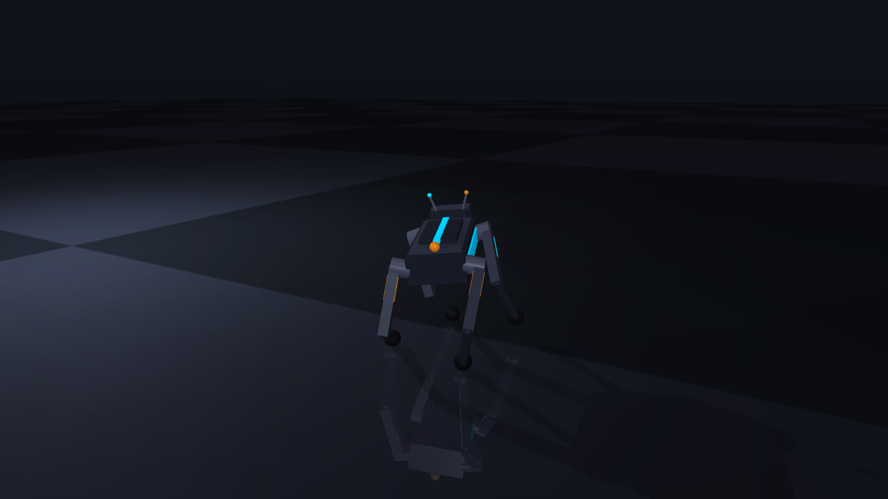

# 🐕 Voice-Controlled Robot Dog (RL in Simulation)

Train a four-legged robot to **walk and turn** in physics simulation with deep
reinforcement learning, then **talk to it** — speak a command, it obeys in the
viewer and replies out loud. Everything runs locally on a Mac. No hardware.



```
🎤 "walk forward, then turn left"
      │  Whisper (speech-to-text)
      ▼  Ollama LLM (intent → command)
   { vx: 0.6, yaw: 0.6 }
      │  PPO policy (trained in MuJoCo)
      ▼  12 joint commands → robot trots and curves left
🔊 "Curving off to the left!"   (macOS `say`)
```

## What it does

- A custom **12-joint robot dog** (3 motors per leg, incl. a hip-abduction
  joint) trained from scratch with PPO to follow velocity + turn commands:
  stand, walk at any speed, reverse, and **turn left/right**.
- **Tricks**: sit, lie down, wave a paw, dance, play-bow, spin — choreographed
  keyframe motions played through the same PD controller as the policy
  (the same way real robot-dog demos are choreographed), each one
  physics-verified so it never falls.
- **Fetch**: say *"go get the ball"* — a glowing ball drops into the world and
  the robot **autonomously navigates to it, steering around the crates in the
  arena** (potential-field guidance driving the RL walking policy), then
  celebrates with a butt-wiggle.
- **Patrol**: *"patrol the arena"* — loops a waypoint circuit endlessly, a
  glowing flag marking the current target (full lap in ~24 s).
- **Follow**: *"follow the ball"* — the ball wanders the arena and the robot
  tails it (~0.5 m tracking distance).
- **Webcam drive** (`brain/follow_me.py`): hold a bright orange object up to
  your webcam — the robot turns and walks wherever you move it.
- **Mood eyes**: the visor glows cyan when idle, orange during tricks, green
  while fetching.
- A **voice layer** that turns natural speech into commands and talks back with
  personality — movement, tricks, *and* free chat ("who are you?" gets an
  in-character answer). All local & offline.
- **Robustness**: Whisper silence-hallucination filtering (no more phantom
  "The The The" commands) and unbounded episodes (the robot no longer
  teleports back to origin after 20 s of demo).

## Control: PD position control, body-frame everything

The policy does **not** output torques. It outputs **target joint angles**
(offsets from a standing pose); a PD loop (`τ = Kp·(target−q) − Kd·q̇`,
Kp=25, Kd=0.7) turns them into smooth motor torques each sim step. This is the
standard, stable way to train legged robots — raw torque control led to a
collapsed, foot-sliding gait that still tracked velocity (a trap the old
velocity-only eval failed to catch).

Observations and rewards are **body-frame** (projected gravity + body-frame
velocities — verified exactly heading-invariant). The first version rewarded
*world*-frame x-velocity, and the policy dutifully learned to walk **only when
facing east**: fetch would navigate out, turn around, face the ball… and
freeze. Body-frame training fixed walking at every compass heading (verified
N/E/S/W), which is what makes patrol loops and fetch-from-any-angle possible.

## Results (`evaluate_v2.py` — checks velocity **and** posture **and** foot-slip)

| Command | Asked | Measured | Height | Slip |
|---|---|---|---|---|
| stand still | 0 | 0.00 | 0.27 | 0.02 ✅ |
| walk slow | 0.3 m/s | 0.31 | 0.28 | 0.20 ✅ |
| walk fast | 0.6 m/s | 0.62 | 0.28 | 0.29 ◑ |
| turn left | +0.6 rad/s | +0.64 | 0.27 | 0.16 ✅ |
| turn right | −0.6 rad/s | −0.67 | 0.27 | 0.12 ✅ |
| walk + turn | 0.4 / 0.4 | 0.40 / 0.33 | 0.28 | 0.27 ◑ |

Stands tall (0.27 m), turns cleanly both ways, walks at the commanded speed.
Forward foot-slip is low (clean step at slow speed; a slight drag at top
speed, ◑). The eval deliberately scores foot-slip and height so a collapsed
or sliding policy cannot pass on velocity alone. See `robot_demo.mp4`.

## Tech stack

| Part | Tool |
|------|------|
| Physics sim | [MuJoCo](https://mujoco.org) |
| RL | [Gymnasium](https://gymnasium.farama.org) + [Stable-Baselines3](https://stable-baselines3.readthedocs.io) (PPO) |
| Speech-to-text | [faster-whisper](https://github.com/SYSTRAN/faster-whisper) |
| Intent / chat | [Ollama](https://ollama.com) (llama3.2:3b), local & offline |
| Text-to-speech | macOS built-in `say` |

## Quick start

```bash
python3.11 -m venv .venv && source .venv/bin/activate
pip install -r requirements.txt

# EITHER: use the pretrained policy shipped in this repo (skip training)
mkdir -p checkpoints_v2 && cp models/final/* checkpoints_v2/

# OR: train from scratch (resume-capable, ~50 min on an M-series Mac)
caffeinate -i python training/train_v2.py

python training/evaluate_v2.py     # check walk + turn tracking
python scripts/render_walk.py      # render robot_demo.mp4

# talk to it!  (needs Ollama: `brew services start ollama` + `ollama pull llama3.2:3b`)
mjpython brain/talk_to_robot.py    # macOS: mjpython, not python
```

Try: *"walk forward"*, *"turn left"*, *"sit"*, *"wave hello"*, *"dance"*,
*"take a bow"*, *"spin around"*, *"go fetch the ball"*, *"stop"*, *"goodbye"* —
or just chat with it.

Keyboard alternative: `mjpython brain/controller.py`
(number=speed · l/r=turn · s=stop · `t sit|wave|dance|bow|lie` · f=fetch · p=spin).

## Project layout

```
sim/
  assets/robot_v2.xml    # the 12-joint robot dog (sleek robot styling)
  envs/robot_v2_env.py   # 39-d obs, 12 actions, gait clock + velocity/turn reward
training/
  train_v2.py            # PPO training (resume-capable)
  evaluate_v2.py         # walk + turn command tracking
scripts/render_walk.py   # renders the showcase video (walk, tricks, fetch)
brain/
  controller.py          # mode machine: POLICY walk/turn · TRICK · NAVIGATE (fetch) · SPIN
  tricks.py              # keyframe choreography engine (sit/lie/wave/dance/bow/wiggle)
  nlu.py                 # speech → {action, vx, yaw, trick, reply} via Ollama
  voice.py               # Whisper STT (w/ hallucination filter) + `say` TTS
  talk_to_robot.py       # full pipeline + console UI
```

## Development

```bash
pip install -e ".[dev]"
pytest -q                              # 85 tests, ~3 s, no services needed
python training/train_v2.py --smoke    # end-to-end pipeline check, ~5 s
python training/benchmark.py           # robustness under perturbed dynamics
```

**Tests** (`tests/`) run entirely offline — no Ollama, microphone, camera, or
GPU. Each one guards a defect this project actually hit:

| Test | Regression it guards |
|---|---|
| `test_env.py::test_observation_is_heading_invariant` | policy once walked only when facing east |
| `test_env.py::test_pd_control_holds_standing_pose` | torque control collapsed the robot to 0.15 m |
| `test_tricks.py::test_trick_keeps_the_robot_upright` | `bow`/`dance` poses tipped it over |
| `test_controller.py::test_no_teleport_during_a_long_run` | episode truncation teleported it mid-demo |
| `test_controller.py::test_concurrent_mode_switching_does_not_crash` | voice thread raced the physics thread |
| `test_brain.py::test_hallucinated_transcripts_are_dropped` | Whisper turned silence into "The The The" |

The trick-safety tests are mutation-tested: reverting `bow` to its original
pose makes them fail with uprightness −0.22, so they are not vacuous.

**Configuration.** `sim/config.py` is the single source of truth for PD gains,
torque limits, the standing pose, gait timing, reward weights, and
randomization ranges. These used to be duplicated across the env, the
controller, and the trick engine — tuning one and not the others silently gave
the trick player and the RL policy *different* controllers.

**Reproducibility.** Every run writes `checkpoints_v2/run_manifest.json` with
the git commit (and whether the tree was dirty), the seed, the full env config,
PPO hyperparameters, and library versions:

```bash
python training/train_v2.py --fresh --seed 42          # reproducible
python training/train_v2.py --no-domain-rand           # ablation
```

**Robustness benchmark.** `evaluate_v2.py` scores command tracking under
nominal physics; `benchmark.py` scores it under *perturbed* physics (ice,
payload, weak/stiff motors, and a combined worst case) — because a policy that
only works on the exact dynamics it trained on is the classic sim-to-real
failure. Compare two policies directly:

```bash
python training/benchmark.py --compare models/pre_domain_rand
```

**Measured result** (the shipped `models/final` policy vs. an identical run
with domain randomization + observation noise disabled, 3 seeds/condition):

| Condition | No DR (track err) | With DR (track err) | Change |
|---|---|---|---|
| nominal | 0.096 | 0.127 | +0.031 (slightly worse) |
| ice (friction 0.25×) | 0.132 | 0.088 | −0.044 |
| grippy (friction 2×) | 0.265 | 0.174 | −0.091 |
| payload +1.0 kg | 0.142 | 0.142 | ≈0 |
| weak motors | 0.328 | 0.303 | −0.025 |
| **stiff motors** | 0.526 | 0.198 | **−0.329 (62% better)** |
| worst case (combined) | 0.325 | 0.300 | −0.025 |
| **mean over all conditions** | **0.259** | **0.190** | **−0.069 (27% better)** |

Falls stayed at 0% in both — the PD position controller is inherently
fall-resistant regardless of randomization, so the gain shows up in *tracking
accuracy* under stress, not survival. There's an honest trade-off: on exactly
nominal physics the DR policy is marginally worse (+0.031), which is the usual
cost of a policy that hedges against variation instead of overfitting to one
exact dynamics model. For a robot meant to keep working under motor wear,
payload changes, or a different floor, that trade is worth it.

## The journey

Built iteratively — the dead-ends are part of the story:

1. **8-joint robot** (`quadruped_env.py`) — learned a clean forward trot and
   speed control, but **physically can't turn** (no sideways hip joint).
2. **Unitree Go2** (`go2_env.py`, 12 joints) — can turn, but training a heavy,
   realistic robot needs **GPU-scale simulation**; on a laptop CPU it only
   crept. Kept as a GPU-ready foundation.
3. **Custom 12-joint robot** (`robot_v2.xml`) — added hip-abduction servos to
   the *lightweight* robot. Same fast-training physics that walked in minutes,
   now with the joints needed to turn. **Walks and turns on a laptop CPU.** ✅

## License

Code: MIT. Unitree Go2 model under `sim/assets/go2/`: Apache-2.0
(© Unitree Robotics / Google DeepMind MuJoCo Menagerie).
